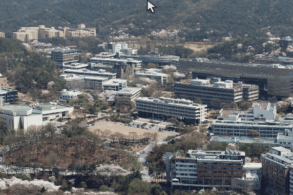

# CampusSeason

An interactive panorama of Seoul National University across four seasons, rendered with WebGL.

Move the mouse **left or right** to explore the panorama, and **up or down** to transition between seasons. On a touchscreen, drag horizontally to pan and vertically to change the season.

[Try the interactive demo and read about the project](https://lee-sangil.github.io/2026-10-26-four-seasons-at-snu-interactive-panorama/).
